

# Guía de arbi, 100% real no fake 1k vitus

Los arbitramientos son misiones donde el drop principal es la esencia Vitus. Se canjea en un relay por honores de arbitramientos y, sobre todo, por Kuva para rolear rivens.

**[Elegir mi misión](#qué-misión-juegas)** &nbsp;|&nbsp; **[Ver el prebuff](#prebuff)**

*Hecha por Gordo Compu si ese soy yo, esta guia es escrita con mis palabras pero toda la informacion esta sacada de la guia oficial de arbis del propio servidor de la misma aquie esta el link con los respectivos creditos [arbi.guide](https://arbi.guide).*

> [!WARNING]
> **Antes de empezar**
>
> Mientras estés en una run de arbitramiento, no presiones Tab ni la letra P. Hacerlo hace que el cliente empiece a laguear de forma recurrente y puede provocar un host migration.
>
> Las builds de Cyte y de armas requieren el procedimiento correcto de prebuff, porque todo el daño se delega en los prebuffs y los supports. Úsalas solo en Arbitrations meta, no en lobbies públicos ni en solo. Si tienes dudas, empieza por las [preguntas frecuentes](#preguntas).

## Índice

- [Elegir misión](#qué-misión-juegas) qué llevar en cada una
- [Espectros](#espectros) cuál y qué plano
- [Prebuff](#prebuff) builds y paso a paso
- [Cyte](#cyte) 4 builds
- [Soporte](#soporte) Wisp, Rhino, Citrine, Vauban
- [Armas](#armas) builds y cómo elegir
- [Tyana Pass](#tyana-pass) qué llevar y cómo lootear
- [Compañeros](#compañeros) Mascota y mods
- [Equipos](#equipos) composiciones y run completa
- [Roar](#cómo-hacer-roar) alcance y uptime
- [Instalooting](#instalooting) evitar el spawnblock
- [Archor y FPS](#archor-y-fps) dos consejos
- [Preguntas](#preguntas) dudas frecuentes y glosario
- [Créditos](#créditos) la guía original

## Qué misión juegas

Cómo se juega y qué llevar en cada misión.

### Defense

Gas se puede usar en Defense, pero no hace falta porque suele ser más fácil que Interception. Thermal Sunder en el Client da daño extra en Defense.

**Cómo se juega**

- **Los enemigos escalan más rápido.** Por eso el daño multiplicativo de Vauban es la mejor opción de soporte.
- **El total de enemigos está fijo.** El número de enemigos por oleada está predeterminado, así que el spawnblocking no lo reduce: la misión solo dura más. Aun así, lootea el Vitus rápido.
- **Deja el objetivo quieto.** Con el Archor dejas el objetivo de la defensa en un sitio cómodo para llegar a rondas altas. Mira [Archor y FPS](#archor-y-fps).
- **Una run completa.** Son 102 oleadas. Gas no hace falta, porque Defense suele ser más fácil que Interception.

**Qué llevar**

| Rol | Build |
|---|---|
| Arma del Host | [Boar Modded Blast (Host)](#armas) |
| Arma del Client | [Strun Wraith (Client)](#armas) |
| Cyte | [Wrathful Advanced (Host)](#cyte) |
| Soporte | [Wisp Roar](#soporte) |

**También:** [Boar Vicious Spread](#armas), [Kohm](#armas), [Boar Crux](#armas), [Cyte Wrathful Advanced Client](#cyte), [Cyte Thermal Sunder Client](#cyte), [Vauban Brightbonnet](#soporte)

### Interception

Vicious Spread se recomienda para Xini y Cytherean, y requiere Thermal Sunder.

**Cómo se juega**

- **Las rondas tienen un timer fijo.** Retrasar spawns por spawnblocking lleva a menos spawns totales. Lootea el Vitus lo más rápido posible y, de preferencia, en el orden en que cayó.
- **Cuida el overkilling.** Cuando mueren los primeros enemigos de un grupo de spawn, el resto del grupo puede no aparecer, y eso reduce el total de enemigos.
- **Rhino es la mejor opción.** Su rugido da mucho daño de facción. Se usa sobre todo en mapas grandes como Callisto, Xini y Cytherean.
- **Una run completa.** Son 10 rondas.

**Qué llevar**

| Rol | Build |
|---|---|
| Arma del Host | [Boar Modded Blast (Host)](#armas) |
| Arma del Client | [Strun Wraith (Client)](#armas) |
| Cyte | [Wrathful Advanced (Host)](#cyte) |
| Soporte | [Wisp Roar](#soporte) |

**También:** [Boar Vicious Spread](#armas), [Boar Crux](#armas), [Cyte Wrathful Advanced Client](#cyte), [Rhino Brightbonnet](#soporte), [Citrine Brightbonnet](#soporte)

### Mirror Defense

Gas se usa en este tipo de misiones porque generan una cantidad más alta de enemigos en comparación con las otras misiones. El gas, poniéndolo muy simplista, “simula” el napalm de la Ogris. Si los DPS llevan gas, nadie del equipo puede llevar algún helminto elemental.

**Cómo se juega**

- **Las rondas tienen un timer fijo.** Igual que en Interception, retrasar spawns lleva a menos spawns totales: lootea el Vitus rápido.
- **Tyana Pass.** Tyana es un mapa que necesita una sección aparte. [Ver Tyana Pass](#tyana-pass)
- **Sin subsumes elementales.** Con Gas no uses Thermal Sunder, Shock ni Nourish.
- **Rhino o Citrine en el soporte.** A Wisp le cuesta más acertar con Roar en estos mapas.

**Qué llevar**

| Rol | Build |
|---|---|
| Arma del Host | [Boar Gas (Host)](#armas) |
| Arma del Client | [Boar Gas (Client)](#armas) |
| Cyte | [Wrathful Advanced (Host)](#cyte) |
| Soporte | [Rhino Brightbonnet](#soporte) |

**También:** [Cyte Wrathful Advanced Client](#cyte), [Citrine Brightbonnet](#soporte)

### Actualización del 11 de octubre

Con la nueva llegada de la nueva actualizacion de los rivens estos han surgido nuevas opciones de rivens para arbitramientos

*Voy a ir actualizando la guía si el meta cambia o si se me pasó algo.*

### Cambios anunciados por DE

| Cambio | Valor |
|---|---|
| Ammo Efficiency | tope de 75% |
| Riven Dispositions | todas a 1.2 |
| Boar 3p1n con Primed Ammo Stock | ~110 a ~95 de cargador |
| Boar 2p1n sin mods de cargador | ~110 a ~80 de cargador |

En los últimos Devshorts. 3p1n significa 3 positivos y 1 negativo.

<a href="#índice">Volver al índice</a>

## Espectros

Qué espectro llevar y qué plano usar.

- **El de Nidus.** Es el espectro por excelencia y el único que se usa principalmente, por la fuerza que da con su link: más fuerza en los buffs durante la misión. Todos los soportes lo necesitan.
- **Planos de 1 estrella.** Puedes usar cualquier plano de espectro, pero lo ideal son los de 1 estrella, porque dan más por plano.

<a href="#índice">Volver al índice</a>

## Prebuff

El famoso prebuff, que a mucha gente se le complica pero es más fácil de lo que parece. Estos son los builds de quienes lo hacen y el orden exacto en que se ejecuta.

<b>Nidus Brightbonnet</b> <kbd>Build meta</kbd>

Todos los soportes (Vauban, Rhino, Jade y Nidus) deben usar sí o sí la Arbucep, el arcgun de Nokko.

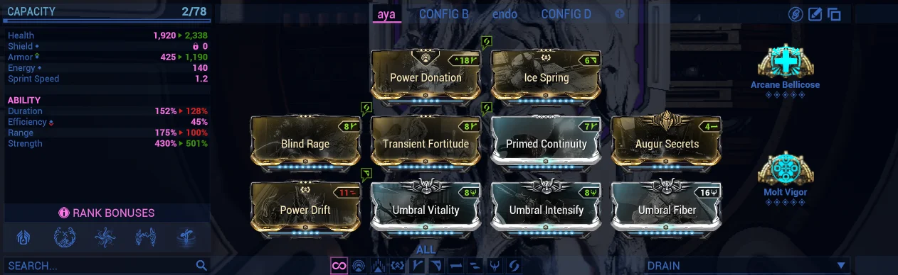

**Detalles**

- Linkea primero a Wisp, espera a que prepare los motes y después linkea a Jade.

| **Archon Shards** | 5x Ability Strength |
|---|---|

Idealmente tauforjados.

> [!NOTE]
> Empower cuando se usa con Wisp BB.

<b>Jade Warcry</b> <kbd>Build meta</kbd>

Todos los soportes (Vauban, Rhino, Jade y Nidus) deben usar sí o sí la Arbucep, el arcgun de Nokko.

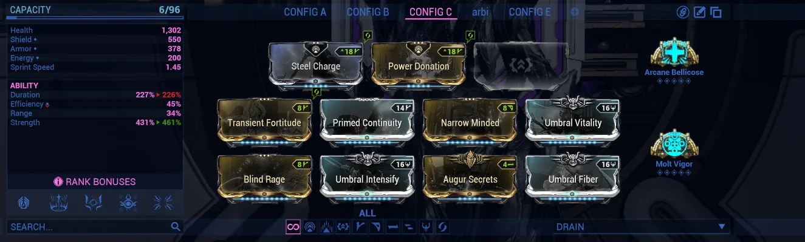

**Detalles**

- La Jade se sale de la misión: al tirar un aura y salirse, esta queda permanente para toda la misión.

| **Archon Shards** | 5x Ability Strength |
|---|---|

Idealmente tauforjados.

<b>Jade Brightbonnet</b>

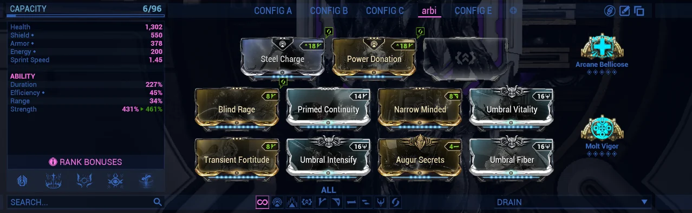

<b>Vauban Brightbonnet</b> <kbd>Build meta</kbd>

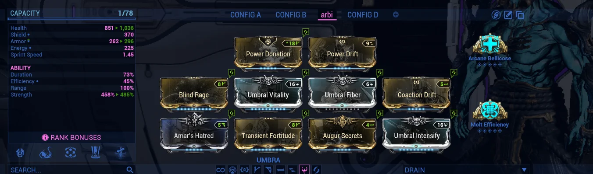

| **Archon Shards** | 5x Ability Strength |
|---|---|

### Secuencia de prebuffing

Son 21 pasos en tres fases. Cada línea indica quién lo hace.

**Fase 1**

1. **Wisp** coloca el mote de Vitality
2. **Nidus** dropea Brightbonnet y lo buffea al 200% con Arbucep
3. **Jade** lanza Hardened Wellspring
4. **Jade** lanza Power of Seven para 150% de Ability Strength
5. **Nidus** activa Sling Strength y Molt Vigor
6. **Nidus** hace Link a Wisp
7. **Wisp** coloca el mote de Vitality
8. **Wisp** activa Sling Strength y Molt Vigor
9. **Wisp** coloca el mote de Haste

**Fase 2**

10. **Nidus** activa Sling Strength y Molt Vigor
11. **Nidus** hace Link a Jade
12. **Jade** recastea Power of Seven
13. **Jade** lanza Warcry
14. **Jade** cambia Power of Seven por Deathbringer
15. **Nidus** sale y se une como Cyte
16. **Jade** cuando ve los buffs de Deathbringer y Warcry en el HUD del Client, sale y se une como Vauban (pre)

**Fase 3**

17. **Vauban** dropea Nidus Specter
18. **Vauban** dropea Brightbonnet y lo buffea al 200% con Arbucep
19. **Vauban** coloca 4 pads uno encima del otro
20. **Vauban** activa Sling Strength y Molt Vigor
21. **Vauban** todos los demás toman los pads; luego Vauban sale y se une con su frame

Video: [Cómo hacer motes, por LaserTurtle42](https://youtu.be/XiT9jwemu3k). La guía indica que el video se actualizará pronto.

### Videos del prebuff

**Prebuff de Jade**

https://github.com/user-attachments/assets/9f232f6d-7808-4348-b38f-43f2fa2414eb

**Prebuff de Nidus**

https://github.com/user-attachments/assets/75f699b5-6d91-4498-8a49-57dabfaa39c5

### Desde el Client y los motes

**Prebuff desde el Client (Nidus).** Depende 100% de la duración de la Jade.

1. Entras como Nidus.
2. Linkeas a la Wisp para que coloque los motes.
3. Linkeas a la Jade y esperas a que ella tire el buff de daño.
4. Te sales y vuelves a entrar como Cyte. Asegúrate de tener el buff de daño del aura de Jade; cuando lo tengas, la Jade se sale y listo.

**Combo de Wisp para los motes.** Es más fácil de lo que uno cree.

1. Activar Madurai.
2. Activar vigor.
3. Esperar el link del Nidus.
4. Lanzar el mote de vida (rojo).
5. Activar Madurai.
6. Activar vigor.
7. Esperar el segundo link del Nidus (porque se activa Bellicose de él).
8. Lanzar el mote de cadencia (verde).

**Combo de Wisp**

https://github.com/user-attachments/assets/b801c3bf-80d0-4671-92a4-ae02bfb65f6c

<a href="#índice">Volver al índice</a>

## Cyte

Los subsumes del DPS. El Cyte Client necesita el build de Nidus Prebuff. Ver el [POV de Cyte en Arbitration](https://www.youtube.com/playlist?list=PLePgtsuwWIDhxPtQ3sjrbaj5BgdKDKY78).

Les dejo POVs de gente del server de arbis, porque no he podido grabar una run de cada mapa. Igual les servirá para tener una noción de cómo es Cyte.

<b>Wrathful Advanced (Host)</b> <kbd>Build meta</kbd>

Es la build estándar de Cyte para Boar o Kohm, lo que gustes.

 

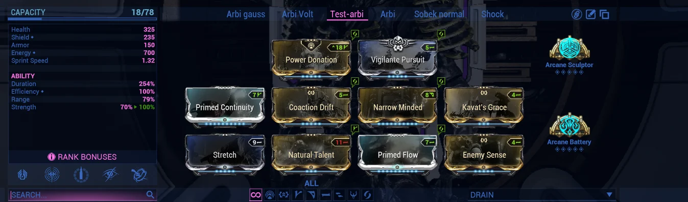

*Si no tienes Arcane Sculptor:*

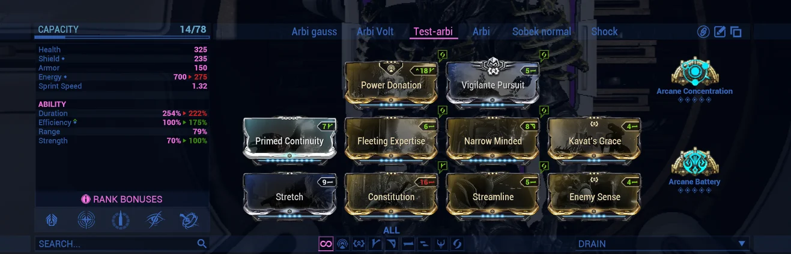

**Detalles**

- Boar con riven de Ammo Efficiency
- Kohm

| **Archon Shards** | 3x Parkour Velocity 2x Casting Speed |
|---|---|

(Strun/Boar). Las dos capturas de arriba son de la guía: el ajuste Invert Tap/Hold Abilities y el slot de Kullervo.

> [!NOTE]
> Variante en la guía de Gordo Compu: 2x Parkour Velocity y 3x Casting Speed.

<b>Wrathful Advanced (Client)</b> <kbd>Build meta</kbd>

 

*Si no tienes Arcane Sculptor:*

**Se usa cuando no se necesita Thermal Sunder**

- Modded Blast
- Wisp Thermal Sunder

| **Archon Shards** | 3x Parkour Velocity 2x Casting Speed |
|---|---|

Con Arcane Consequence puedes cambiar shards de PV por shards de Primary Status Chance.

> [!NOTE]
> Si sientes que tienes demasiado PV con Arcane Consequence, puedes bajar el rango o reemplazar algunos shards de Parkour Velocity por shards de Primary Status Chance.

<b>Thermal Sunder (Client)</b>

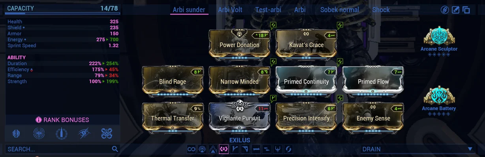

**Se usa cuando se necesita Thermal Sunder**

- Sin Modded Blast ni Wisp Thermal Sunder
- Daño extra para misiones Defense
- Se recomienda con Client más que con Host, con Boar, Strun o Kohm

| **Archon Shards** | 3x Parkour Velocity 2x Casting Speed |
|---|---|

(Strun/Boar)

> [!CAUTION]
> No uses Nidus Specter si tienes el buff de Invig/Arbi: lanzar Sunder sobre 1200% causa lag. Esta build laguea el doble que la normal.

> [!NOTE]
> Variante en la guía de Gordo Compu: 2x Parkour Velocity y 3x Primary Status Chance.

<b>Escuela Unairu</b>

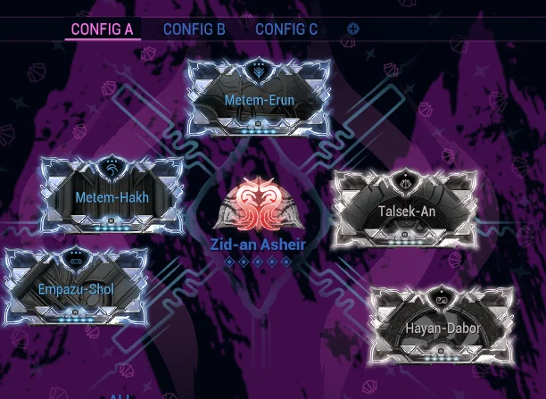

**Detalles**

- Se usa esta escuela por su ataque Tauron, que da armadura y permite tener al máximo la Sobrecarga primaria.

<a href="#índice">Volver al índice</a>

## Soporte

Wisp requiere Afentis y Nidus Specter. Rhino, Citrine y Vauban requieren Arbucep, el build Jade Prebuff y Nidus Specter.

#### Wisp

<b>Wisp Roar</b> <kbd>Build meta</kbd>

Requiere Afentis y Nidus Specter.

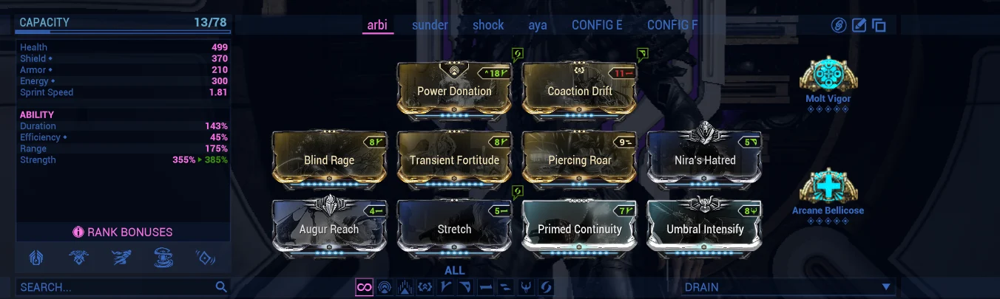

**Detalles**

- Wisp por defecto
- Es la encargada de dar cadencia a los DPS y algo de supervivencia con los motes de vida
- Build estándar para usar junto al soporte Vauban

| **Archon Shards** | 4x Ability Strength 1x Parkour Velocity* |
|---|---|

*Todas las builds de Wisp usan 4x Ability Strength y 1x Parkour Velocity. Si usas 5x Ability Strength, cambia Coaction Drift por Mobilize.

<b>Wisp Thermal Sunder</b> <kbd>Build meta</kbd>

Requiere Afentis y Nidus Specter.

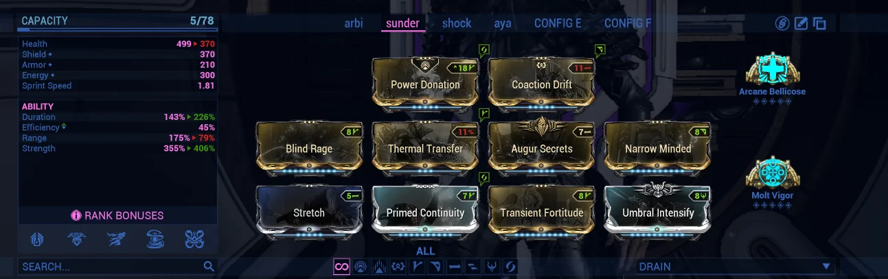

**Detalles**

- Con soporte Rhino BB
- Cuando el Cyte va solo de DPS o ninguno de los DPS quiere ir Thermal

| **Archon Shards** | 4x Ability Strength 1x Parkour Velocity* |
|---|---|

*Todas las builds de Wisp usan 4x Ability Strength y 1x Parkour Velocity. Si usas 5x Ability Strength, cambia Coaction Drift por Mobilize.

> [!CAUTION]
> No uses Nidus Specter: lanzar Sunder sobre 1200% causa lag. Thermal laguea más que las demás.

<b>Wisp Brightbonnet</b>

Requiere Afentis y Nidus Specter.

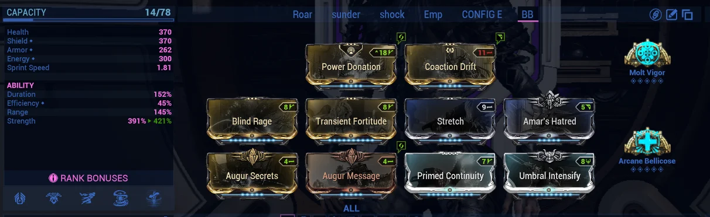

**Detalles**

- Con soporte Citrine Roar (poco común)

| **Archon Shards** | 4x Ability Strength 1x Parkour Velocity* |
|---|---|

*Todas las builds de Wisp usan 4x Ability Strength y 1x Parkour Velocity. Si usas 5x Ability Strength, cambia Coaction Drift por Mobilize.

<b>Wisp Empower</b>

Requiere Afentis y Nidus Specter.

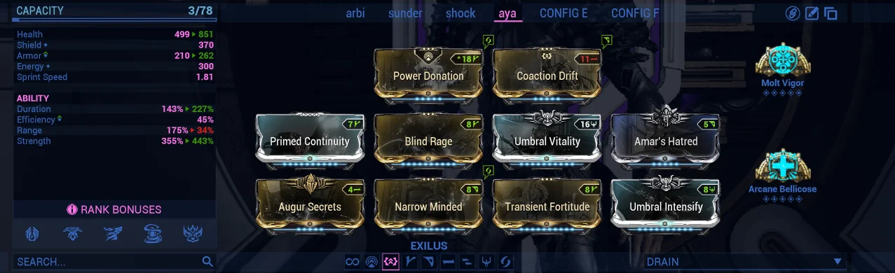

**Detalles**

- Da la mayor cantidad de cadencia, porque Empower da 50% más de fuerza para la siguiente habilidad
- Se usa en la composición Cyte, Wisp (Empower), Vauban Shock y Rhino BB

| **Archon Shards** | 4x Ability Strength 1x Parkour Velocity* |
|---|---|

*Todas las builds de Wisp usan 4x Ability Strength y 1x Parkour Velocity. Si usas 5x Ability Strength, cambia Coaction Drift por Mobilize.

#### Rhino

<b>Rhino Brightbonnet</b> <kbd>Build meta</kbd>

Requiere Arbucep, el build Jade Prebuff y Nidus Specter.

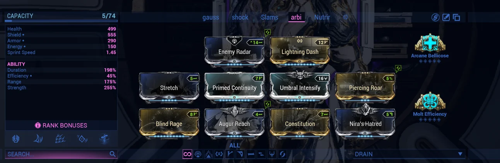

**Detalles**

- Se usa por su rugido, que da un montón de daño de facción
- Mapas grandes de Interception (Callisto, Xini, Cytherean)
- Mirror Defense (Tyana Pass, Munio), donde a Wisp le cuesta más acertar con Roar

| **Archon Shards** | 2x Ability Strength 2x Casting Speed 1x Parkour Velocity |
|---|---|

> [!NOTE]
> Variante en la guía de Gordo Compu: 3x Ability Strength y 2x Casting Speed.

#### Citrine

<b>Citrine Brightbonnet</b> <kbd>Build meta</kbd>

Requiere Arbucep, el build Jade Prebuff y Nidus Specter.

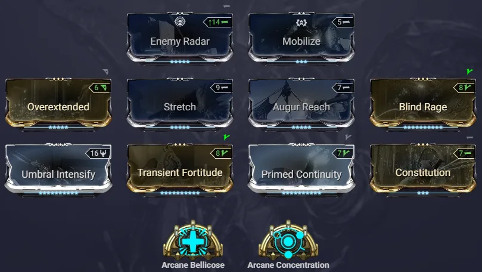

**Detalles**

- Mapas de Interception y Mirror Defense con comps de Blast o Gas

| **Archon Shards** | 2x Ability Strength 2x Casting Speed 1x Parkour Velocity |
|---|---|

<b>Citrine Roar</b>

Requiere Arbucep, el build Jade Prebuff y Nidus Specter.

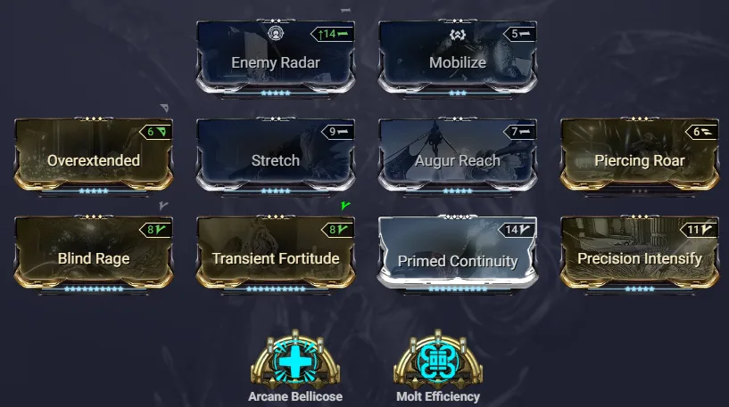

**Detalles**

- Build poco común
- Mapas de Interception y Mirror Defense con comps de Blast o Gas

| **Archon Shards** | 3x Ability Strength 1x Casting Speed 1x Parkour Velocity |
|---|---|

#### Vauban

<b>Vauban Brightbonnet</b> <kbd>Build meta</kbd>

Requiere Arbucep, el build Jade Prebuff y Nidus Specter.

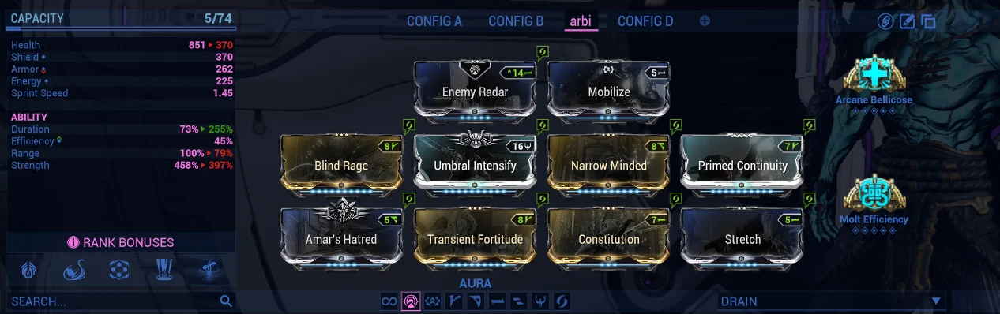

**Detalles**

- Se usa en Defense
- Se usa por sus pads (la segunda habilidad, al mantenerla presionada), que dan daño multiplicativo y velocidad de parkour
- La mejor opción para Defense: los enemigos escalan de nivel más rápido y su daño multiplicativo lo contrarresta

| **Archon Shards** | 5x Ability Strength |
|---|---|

> [!NOTE]
> Variante en la guía de Gordo Compu: 5x Ability Duration, o 3x Ability Duration y 2x Ability Strength.

<a href="#índice">Volver al índice</a>

## Armas

Primero elige según la misión, después abre la build.

| Misión | Host | Client |
|---|---|---|
| **Defense** | Boar (Modded Blast o Vicious Spread) o Kohm | Strun o Boar Crux |
| **Interception** | Boar (Modded Blast o Vicious Spread) | Strun o Boar Crux |
| **Mirror Defense** | Boar Gas | Boar Gas/ O boar blast (pero solo si ya tienes experiencia en mirror defense) |

Secundarias: da igual cuál lleves.

#### Primarias

<b>Boar Modded Blast (Host)</b> <kbd>Build meta</kbd>

Una de las mejores escopetas del juego. Es meta por su gran dispersión de balas y el alto multishot y cadencia que puede tener.

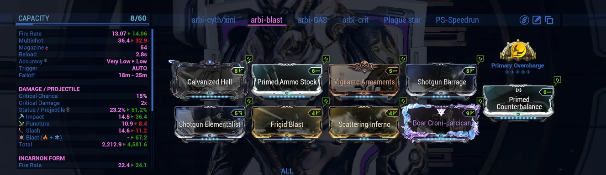

**Detalles**

- No requiere Thermal Sunder
- Usar el suministro de explosión de Cyte
- Si no tienes riven, puedes meterle más cadencia

| **Incarnon** | Evo 2: Reified Bane Evo 3: Ready Retaliation Evo 4: Elemental Balance |
|---|---|
| **Rivens** | `MS FR AE` `MS AE` `MS FR SC` `MS FR` |
| **Negativos** | Impact, Slash, CD, Ammo Max, Reload Speed, Projectile Speed |

> [!NOTE]
> Necesitas un riven AE; si no, tendrás que poner Shotgun Elementalist en lugar de Frail Momentum.

<b>Boar Vicious Spread (Host)</b> <kbd>Build meta</kbd>

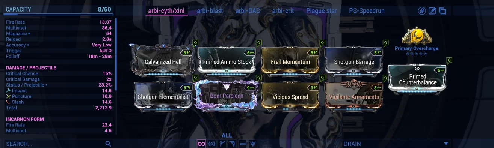

**Detalles**

- Recomendado para Xini/Cytherean
- Vicious Spread rango 2 (puedes probar R1 a R3)
- Requiere Thermal Sunder

| **Incarnon** | Evo 2: Reified Bane Evo 3: Ready Retaliation Evo 4: Elemental Balance |
|---|---|
| **Rivens** | `MS FR AE` `MS AE` `MS FR SC` `MS FR` |
| **Negativos** | Impact, Slash, CD, Ammo Max, Reload Speed, Projectile Speed |

> [!NOTE]
> Necesitas un riven AE; si no, tendrás que poner Shotgun Elementalist en lugar de Frail Momentum.

<b>Kohm (Host)</b>

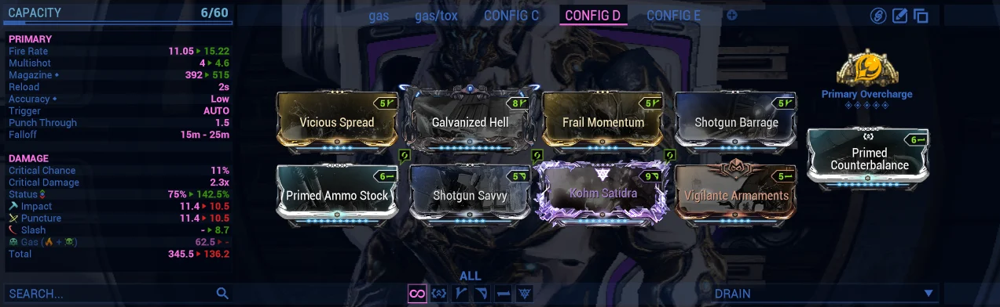

**Detalles**

- Kohm normal (no Kuva)

| **Rivens** | `MS FR` |
|---|---|
| **Negativos** | Slash, CD, SD, Ammo Max, Reload Speed, Projectile Speed |

<b>Strun Wraith (Client)</b> <kbd>Build meta</kbd>

Utilicé la imagen de la guía original porque no tengo la Strun buildeada.

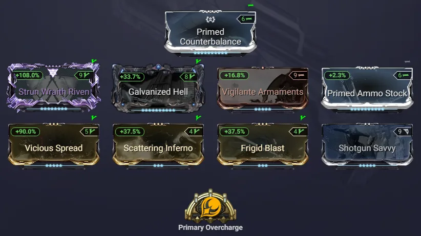

| **Incarnon** | Evo 2: Blazing Barrel Evo 3: Swift Deliverance Evo 4: Elemental Balance |
|---|---|
| **Rivens** | `MS SC AE` `MS SC MC (cambia Shotgun Elementalist por Vigilante Armaments)` `MS SC HEAT/COLD (cambia Burdened Mag por Scattering Inferno/Frigid Blast)` `MS MC HEAT/COLD` |
| **Negativos** | Impact, Fire Rate, Slash, CD, Ammo Max, Reload Speed, Projectile Speed |

<b>Boar Crux (Client)</b> <kbd>Build meta</kbd>

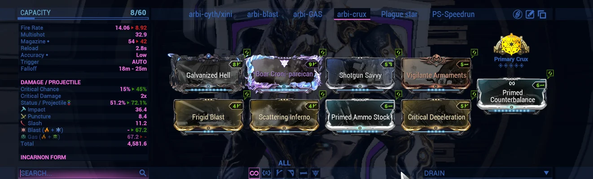

| **Incarnon** | Evo 2: Reified Bane Evo 3: Ready Retaliation Evo 4: Elemental Balance |
|---|---|
| **Rivens** | `MS SC AE` `MS SC` |
| **Negativos** | Impact, Fire Rate, Slash, CD, Ammo Max, Reload Speed, Projectile Speed |

<b>Boar Gas (Host)</b>

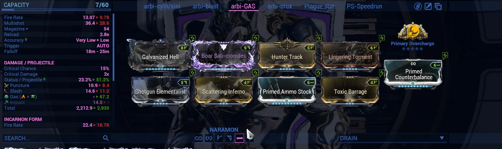

**Uso**

- Mirror Defense (Tyana Pass, Munio)

| **Incarnon** | Evo 2: Reified Bane Evo 3: Ready Retaliation Evo 4: Elemental Balance |
|---|---|
| **Rivens** | `MS SC SD` `MS FR SD` `MS AE SD` `MS SD` |
| **Negativos** | Impact, Slash, CD, Ammo Max, Reload Speed, Projectile Speed |

> [!CAUTION]
> No lo uses con subsumes elementales (Thermal Sunder, Shock o Nourish).

<b>Boar Gas (Client)</b>

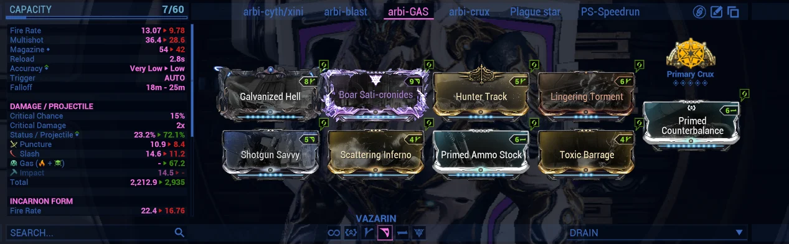

**Uso**

- Mirror Defense (Tyana Pass, Munio)

| **Incarnon** | Evo 2: Reified Bane Evo 3: Ready Retaliation Evo 4: Elemental Balance |
|---|---|
| **Rivens** | `MS SC SD` `MS SD` |
| **Negativos** | Impact, Fire Rate, Slash, CD, Ammo Max, Reload Speed, Projectile Speed |

> [!CAUTION]
> No lo uses con subsumes elementales (Thermal Sunder).

#### Otras armas

<b>Afentis Prime</b>

Es el arma que debe usar principalmente Wisp: lánzala cada 10 a 20 segundos.

**Detalles**

- El aura que spawnea otorga cadencia, velocidad de recarga y menos retroceso

<b>Praedos</b>

**Detalles**

- Se usa por su velocidad de parkour, con sus evoluciones

### Si el Client tiene lag

El lag depende del ping, el mapa, el Multishot, el Fire Rate y las specs del PC. Juega con un Host de menor ping o elige un arma con menos Multishot y Fire Rate. También puedes quitar Reinforced Bond o usar un riven con Fire Rate negativo.

| Arma | Multishot | Fire Rate | Pellets/s |
|---|---|---|---|
| Strun OC | 90.66 | 32.13 | **2912.45** |
| Boar Crux | 44.43 | 60.01 | **2666.34** |

> [!TIP]
> Aunque Strun tiene más pellets/s que Boar Crux, mucha gente rinde mejor con Boar Crux porque tiene más Multishot y menos Fire Rate. Prueba un Overcharge de rango menor (R2) antes de cambiarte a Boar Crux. Si aun así tienes lag con Boar Crux, usa Hell’s Chamber en lugar de Galvanized Hell.

<a href="#índice">Volver al índice</a>

## Tyana Pass

Nodo de Mirror Defense donde los enemigos aparecen con mucha más intensidad. Es de los mapas hiper grandes, junto con Xini y Cytherean.

- **Qué llevar.** Gas. Boar Gas como Host o Client. Se usa con el suministro de gas de Cyte.
- **Qué evitar.** Con Gas no uses subsumes elementales: ni Thermal Sunder, ni Shock, ni Nourish.
- **Soporte.** Rhino o Citrine Brightbonnet, porque a Wisp le cuesta más acertar con Roar. El Roar de Rhino o Citrine llega a 76.25 m; el de Wisp, a 53.75 m.

> [!NOTE]
> En Interception existe el “overkilling”: cuando mueren los primeros enemigos de un grupo de spawn, el resto puede no aparecer. Tyana Pass y Munio generan enemigos con mucha más intensidad, así que conviene usar Gas.

### Cómo lootear

En Tyana Pass el método para lootear es distinto, porque el Vitus también puede caer en el Void (el vacío) y ahí también aparecen enemigos. La característica del Void es que, cuando al menos un jugador está dentro, dejan de aparecer enemigos en la zona donde estás defendiendo. Por eso el método de looteo es este:

- **Si salen 1 o 2 Vitus en el vacío.** Déjalos ahí. Sacarás más Vitus simplemente recogiendo los que dropeen en la zona.
- **Si salen 3, 4 o más Vitus.** Ahí sí puedes ir a lootear, pero lo tiene que dictaminar el host. El host da el aviso de cuándo tienen que ir todos, porque si uno va tarde va a joder el spawn de enemigos.

> [!TIP]
> Idealmente, y solo si es posible, ve a Tyana Pass con un squad que pueda estar en chat de voz, al menos para que el host dicte cuándo lootear en el vacío.

**Builds para este nodo:** [Boar Gas Host](#armas), [Boar Gas Client](#armas), [Rhino Brightbonnet](#soporte), [Citrine Brightbonnet](#soporte)

<a href="#índice">Volver al índice</a>

## Compañeros

En compañeros no es tan exigente. Mientras uses una mascota con Primed Animal Instinct y el mod Resourceful Retriever, vas bien.

> [!TIP]
> Idealmente, los DPS usan el Kavat Adarza por el 60% de probabilidad crítica que da a los aliados en un radio de 25 metros durante 13 segundos.

<a href="#índice">Volver al índice</a>

## Equipos

Cinco composiciones para armar tu squad. Una run completa son 102 oleadas en Defensa y/o 10 rondas de Interceptación.

| Jugador 1 | Jugador 2 | Jugador 3 | Jugador 4 | Para |
|---|---|---|---|---|
| Cyte | Cyte | Wisp (Rugido) | Vauban BB |  |
| Cyte | Cyte | Wisp (Thermal) | Rhino BB |  |
| Cyte | Wisp (Empower) | Vauban Shock | Rhino BB |  |
| Cyte | Cyte | Wisp BB | Citrine Roar | Para Gas |
| Cyte | Cyte | Wisp Roar | Citrine BB | Para Gas |

<a href="#índice">Volver al índice</a>

## Cómo hacer Roar

Hasta dónde llega y cuándo recastearlo.

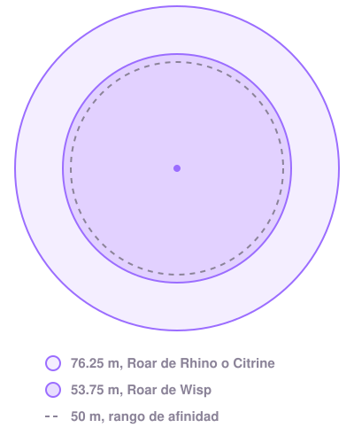

| Radio | Detalle |
|---|---|
| **53.75&nbsp;m** | Radio de Roar con un Wisp de 175% de rango. El rango de afinidad es de 50 m y el HUD muestra un indicador cuando un aliado está dentro. Úsalo para saber si alguien está dentro del rango de Roar. |
| **76.25&nbsp;m** | Radio de Roar con Rhino o Citrine de 265% de rango. Cubre casi todo el mapa si lo lanzas desde el centro. |

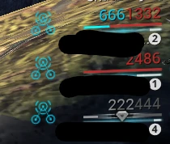 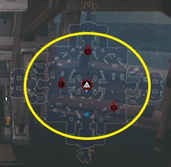

> [!TIP]
> **Recastea cuando caiga Vitus.** Cuando todos estén en el camp spot y caiga Vitus, recastea Roar para que el DPS tenga el mayor uptime posible antes de ir a lootear.

> [!IMPORTANT]
> **No esperes el Link de Nidus.** Es más importante tener 100% de uptime de Roar que esperar a que te linkeen. Puedes recastearlo una vez linkeado.

> [!NOTE]
> **La animación de cast quita el buff.** Durante la animación de Roar, tu DPS pierde el buff. Rhino y Citrine usan 2 shards de Casting Speed, así que no es problema. Wisp no tiene espacio para esos shards. Como Wisp, aprovecha “Power Transfer” de Madurai, que da 20 s de 50% de Casting Speed al cambiar a Warframe desde Operator.

<a href="#índice">Volver al índice</a>

## Instalooting

En Warframe, los enemigos no aparecen si hay línea de visión (LoS) sobre sus puntos de spawn. Impedir spawns así se llama spawnblocking.

- **En Defense.** El número de enemigos por oleada está predeterminado, así que el spawnblocking no reduce el total de spawns. La misión sí dura más.
- **En Interception y Mirror Defense.** Las rondas tienen un timer fijo, así que retrasar spawns por spawnblocking lleva a menos spawns totales.

Para minimizar el spawnblock, lootea el Vitus lo más rápido posible (“instaloot”) y, de preferencia, en el orden en que cayó. Lootea el Vitus a través de las paredes siempre que puedas, en vez de abrir puertas y entrar a las salas de spawn.

> [!CAUTION]
> No lootees nada que no sea Vitus. Eso incluye Riven Slivers, Argon Crystal y similares.

<a href="#índice">Volver al índice</a>

## Archor y FPS

Dos cosas que ayudan a llegar a rondas más altas y a farmear más Vitus.

### Archor

Es una mecánica para dejar el objetivo de la defensa quieto en un sitio específico, así es más cómodo y fácil llegar a rondas altas. Según el mapa se hace de una manera u otra, pero en el papel termina siendo lo mismo.

1. Todo el squad se pone en operador.
2. El host activa la defensa como operador.
3. Guía al objetivo al lugar donde quieren dejarlo quieto (donde no le vaya a caer un meteorito).
4. Cuando vean que el objetivo ya no se mueve, cambian al Warframe y juegan normal.

> [!CAUTION]
> El host no debe volver a sacar el operador en defensa por nada del mundo: el objetivo podría moverse y oneshotearlo.

### Más FPS, más enemigos

**+200 FPS.** Por alguna razón, mientras más FPS tienes, más enemigos spawnean. Quien tenga más de 200 FPS puede farmear más Vitus.

No es 100% obligatorio tener más de 200 FPS: con 100 ya puedes sacar muy buen Vitus. Incluso hay gente con 50 FPS que saca más de 1k por run en tiers S.

<a href="#índice">Volver al índice</a>

## Preguntas

Las dudas más comunes sobre las builds.

<b>¿Por qué Wrathful Advanced? ¿Por qué rango negativo?</b>

Wrathful Advanced ayuda mucho con el movimiento, y eso ayuda contra el spawnblocking. No se necesita rango en WA porque se usa como reset de Bullet Jump en vez de como teletransporte. Puedes hacer bullet jump, WA y bullet jump otra vez sin aterrizar.

<b>¿Puedo usar Infested Mobility en lugar de Wrathful Advanced?</b>

Sí. Wrathful Advanced se usa más porque ya usamos shards de Parkour Velocity y WA permite cambiar de dirección en el aire. Si prefieres Infested Mobility, puedes cambiar los shards de Parkour Velocity por shards de Primary Status Chance.

<b>¿Por qué no Shock ni Nourish?</b>

Con los buffs que tenemos hoy, los subsumes de daño no hacen falta. Thermal Sunder se usa sobre todo para dar Blast (cuando no se modea para eso) o más peso elemental de Blast. Shock y Nourish interfieren con Blast porque aportan su propio peso elemental.

<b>¿Por qué modeamos Status Chance si Resupply fuerza procs de estado?</b>

Resupply no fuerza el proc si un enemigo muere de una sola bala, y con nuestros buffs eso es lo que pasa. Por eso modeamos Status Chance en Boar, para conseguir el AOE de Blast (o de Gas).

<b>No tengo el Icarnon Adapter de Boar ni de Strun. ¿Puedo usarlos igual?</b>

Sí. El incarnon se usa sobre todo por el Status Chance base más alto de Evolution 4, Elemental Balance. Como Host, reemplazaría los mods de Blast y Status Chance por mods de Fire Rate (Accelerated Blast o Vigilante Fervor), porque el Status Chance sería muy bajo. El Client puede usar las mismas builds de la lista.

<b>¿Por qué solo usamos Gas en algunos mapas (Tyana Pass y Munio)?</b>

En los mapas de Interception existe el “overkilling”: cuando mueren los primeros enemigos de un grupo de spawn, el resto del grupo puede no aparecer, y eso reduce el total de enemigos (aunque los Cytes con menos experiencia podrían rendir mejor igualmente con Gas). Tyana Pass y Munio (Mirror Defense) generan enemigos con mucha más intensidad, así que conviene usar Gas. También se puede usar Gas en Defense, pero no hace falta porque suelen ser más fáciles que Interception.

### Glosario

| Sigla | Significado |
|---|---|
| **AE** | Ammo Efficiency |
| **WA** | Wrathful Advanced |
| **BB** | Brightbonnet |
| **PV** | Parkour Velocity |
| **MS** | Multishot |
| **FR** | Fire Rate |
| **SC** | Status Chance |
| **CD** | Critical Damage |
| **CC** | Critical Chance |
| **SD** | Status Duration |
| **LoS** | línea de visión |
| **VE** | Vitus Essence |

La guía original no define MC; se deja igual.

<a href="#índice">Volver al índice</a>

## Créditos

No soy el creador de todo esto ni de toda esta información. Traté de explicarla a mi manera y que se entienda. La información completa está en inglés en la Warframe Arbitrations Guide, y a sus autores se les dan los créditos.

- [Abrir arbi.guide](https://arbi.guide/#introduction)
- [Arbi guide docs](https://docs.google.com/document/d/1apLmDipiKi5vSMbyA65snZDVeHryyWDh1zhce4kRvcA/edit?usp=sharing)
